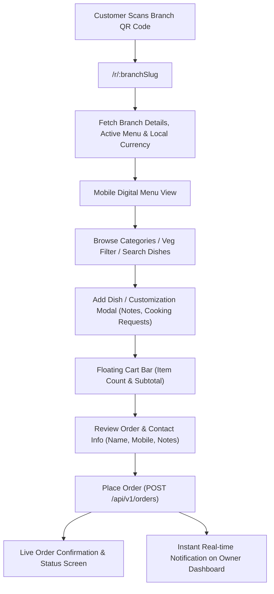

# Customer QR Storefront – Architecture & Implementation Plan

## 1. Executive Summary & Core Objective

The **Customer QR Storefront** is a high-performance, mobile-first **Progressive Web App (PWA)** that diners/customers open when scanning a restaurant branch's storefront QR code or visiting their direct link.

- **Primary Entrypoint**: `/r/:branchSlug` (e.g., `https://instantqr.com/r/ananda-non-veg-theppakulam`)
- **Core Goal**: Provide an ultra-fast (<1s initial load) digital storefront where customers can browse categories, filter dietary preferences (Veg/Non-veg), see live branch pricing and real-time stock availability, customize items, and place digital orders directly to the branch.
- **Scope Note**: Table assignment/table QR management is intentionally excluded from this phase. Customers scan the branch storefront QR or open the branch link directly to browse and order.

---

## 2. PWA (Progressive Web App) Architecture

Both the **Customer Storefront** and the **Restaurant Owner App** are designed as full PWAs.

### Customer Storefront PWA Characteristics:
1. **Zero App-Store Friction**: Diners scan the branch QR code and immediately access a native-feeling mobile app with zero download requirement.
2. **Web App Manifest (`manifest.webmanifest`)**:
   - `display: standalone` (runs fullscreen without browser URL bars or navigation clutter).
   - Dynamic theme color matched to the restaurant brand styling.
   - High-resolution icons (`192x192`, `512x512`, maskable).
3. **Service Worker & Caching Shell (`vite-plugin-pwa`)**:
   - Pre-caches core app shell, fonts, and icons.
   - Fast stale-while-revalidate caching for food images and static categories.
   - Resilient offline fallback if mobile data temporarily drops.
4. **Installable Shortcut**: Option to save the branch storefront directly to mobile home screen.

---

## 3. Customer Journey & Core Flow

---

## 4. UI/UX Feature Breakdown

### A. Storefront Header & Branch Identity
- **Restaurant Brand Logo & Concept**: Concept name, branding, and logo.
- **Physical Branch Details**: Branch name, street address, and contact phone with click-to-call.
- **Branch Currency Display**: All prices automatically formatted in the branch's specific billing currency (₹, $, €, £, AED, etc.).

### B. Category Navigation & Dietary Filters
- **Sticky Category Bar**: Smooth horizontal scrolling pills (*"Starters"*, *"Main Course"*, *"Beverages"*). Tapping a category scrolls directly to that section.
- **Veg / Non-Veg Quick Filter**: Toggle switch to instantly display only vegetarian items.
- **Search Bar**: Instant filter by dish name or description.

### C. Food Item Card & Real-time Stock Enforcement
- **Dish Photo**: Responsive, optimized thumbnail with fallback initial badge.
- **Dietary Badge**: Green square/dot for Vegetarian, red triangle for Non-Vegetarian.
- **Dish Title & Description**: Name and item details.
- **Branch Price**: Displays the effective price (local branch override if configured, otherwise base catalog price).
- **Live Stock Status**:
  - If marked **Out of Stock** in the Branch Matrix:
    - Card displays a prominent `"Sold Out"` badge.
    - Dimmed opacity (grayscale).
    - `ADD` button is disabled to prevent ordering unavailable items.
  - If **In Stock**:
    - Tap `+ ADD` or quantity stepper (`- 1 +`).

### D. Item Customization & Special Requests
- Tap dish to open a bottom sheet modal:
  - Special preparation instructions (e.g., *"Less spicy"*, *"No coriander"*).
  - Add to cart confirmation.

### E. Floating Cart & Checkout Sheet
- **Floating Bottom Bar**: Visible whenever items are in the cart. Displays total count, subtotal in branch currency, and `"View Cart"` action.
- **Cart Sheet / Drawer**:
  - Itemized list with quantity steppers and notes.
  - Bill breakdown: Subtotal, local taxes/fees (if enabled), and grand total.
  - Customer contact details: Customer Name & Phone Number (for order notification and pickup).
  - Order type / notes: Special kitchen instructions.
  - Prominent `"Place Order"` action.

### F. Order Confirmation & Live Tracking
- Once order is submitted:
  - Audio/vibration confirmation on customer's phone.
  - Order token display (e.g., `Order #104`).
  - Live progress tracker: `Order Received` ➔ `Confirmed / In Kitchen` ➔ `Ready`.
  - Button to `"Order More Items"` or view past orders in session.

---

## 5. Technical Architecture & Workspace Setup

### Monorepo Structure:
- **Dedicated PWA Workspace (`apps/customer`)**:
  - Independent Vite + React + Tailwind CSS bundle.
  - Shared TypeScript types and API contracts via `packages/shared-types`.
  - Lean bundle optimized for fast mobile network loading.
- **API Endpoints in Backend (`apps/api`)**:
  1. `GET /api/v1/branch-products/branch/:branchId/menu` (fetches branch currency, categories, products with price overrides and stock status).
  2. `GET /api/v1/branches/by-slug/:slug` (resolves branch ID and details from storefront URL slug).
  3. `POST /api/v1/orders` (creates customer order with branchId, items, customer name, phone, and order notes).
  4. `GET /api/v1/orders/:orderId/status` (live order status tracking).

---

## 6. Implementation Roadmap

| Phase | Milestone | Deliverables |
|---|---|---|
| **Phase 1** | **PWA Setup & Branch Storefront Foundation** | Create `apps/customer`, configure Vite + Tailwind CSS + PWA manifest, setup route `/r/:branchSlug`. |
| **Phase 2** | **Menu Display & Live Stock Integration** | Render branch header, category sticky tabs, dish cards with branch currency, local price overrides, and `Sold Out` status. |
| **Phase 3** | **Cart & Order Placement** | Zustand cart store, bottom sheet review, customer name & phone input, submit order API. |
| **Phase 4** | **Order Confirmation & Tracking** | Order success screen, token display, live status updates. |
| **Phase 5** | **PWA Verification & Mobile Optimization** | Service worker caching, offline fallback, Lighthouse PWA audit (installability, performance score 95+). |
