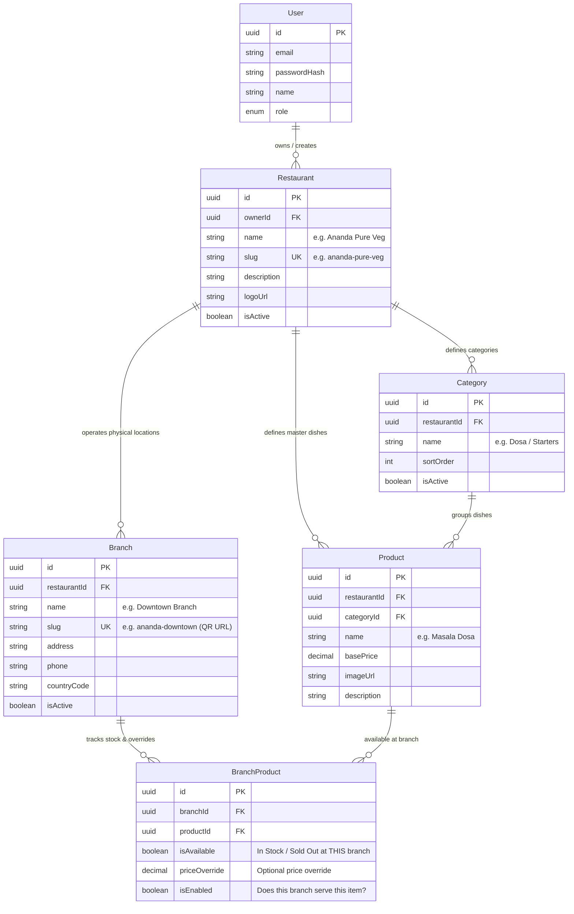

# Architecture & Migration Plan: Restaurant & Branch Hierarchy with Local Availability

## 1. Executive Summary

To support **multi-concept operations** (e.g., 2 Pure Veg branches sharing a Veg menu + 1 Non-Veg restaurant with a distinct Non-Veg menu) alongside **independent per-location stock availability**, the platform adopts the **Restaurant &rarr; Branch &rarr; Catalog &rarr; Branch Override** pattern.

### Core Terminology
- **`Restaurant`**: The food concept & master menu catalog (e.g., *"Ananda Pure Veg"* or *"Babu Non-Veg"*).
- **`Branch`**: The physical storefront location with its own address, contact phone, and table QR code URL slug (e.g., *"Downtown Branch"* &rarr; `/r/ananda-downtown`).
- **`BranchProduct`**: Local stock availability (**In Stock / Sold Out**) and optional price overrides per branch.

### Key Principles
1. **`User` Table Untouched**: Existing authentication, passwords, tokens, and roles remain 100% intact.
2. **Catalog at Restaurant Level**: Categories and dishes are authored once under the **Restaurant** entity.
3. **Branches as Physical Locations**: Branches belong to a Restaurant. Adding dishes to a Restaurant immediately makes them available across all its branches.
4. **Availability & Pricing at Branch Level**: A junction table (`BranchProduct`) tracks live **In Stock / Sold Out** status and optional price overrides per branch.
5. **Phase-Wise Execution**: Work is broken into 5 self-contained phases with zero breaking jumps.

---

## 2. Entity Relationship Diagram



---

## 3. Database Schema Specification (`apps/api/prisma/schema.prisma`)

### What Stays Unchanged
- `User` table (all user accounts, password hashes, IDs, and tokens remain unmodified).
- `Role` enum (`SUPER_ADMIN`, `ADMIN`, `MANAGER`, `STAFF`).

### Tables To Be Migrated
```prisma
// 1. Restaurant (Parent Concept & Master Catalog Holder)
model Restaurant {
  id            String      @id @default(uuid())
  ownerId       String
  name          String
  slug          String      @unique
  description   String?
  logoUrl       String?
  isActive      Boolean     @default(true)
  createdAt     DateTime    @default(now())
  updatedAt     DateTime    @updatedAt
  isDeleted     Boolean     @default(false)
  deletedAt     DateTime?
  deletedBy     String?

  owner         User        @relation(fields: [ownerId], references: [id], onDelete: Cascade)
  branches      Branch[]
  categories    Category[]
  products      Product[]

  @@map("restaurants")
}

// 2. Branch (Physical Storefront Location with QR Code)
model Branch {
  id            String          @id @default(uuid())
  restaurantId  String
  name          String
  slug          String          @unique // Used for Customer QR scan: /r/:slug
  address       String?
  phone         String?
  countryCode   String?
  isActive      Boolean         @default(true)
  createdAt     DateTime        @default(now())
  updatedAt     DateTime        @updatedAt
  isDeleted     Boolean         @default(false)
  deletedAt     DateTime?
  deletedBy     String?

  restaurant    Restaurant      @relation(fields: [restaurantId], references: [id], onDelete: Cascade)
  branchProducts BranchProduct[]

  @@map("branches")
}

// 3. Category (Belongs to Restaurant Catalog)
model Category {
  id            String      @id @default(uuid())
  restaurantId  String
  name          String
  description   String?
  sortOrder     Int         @default(0)
  isActive      Boolean     @default(true)
  createdAt     DateTime    @default(now())
  updatedAt     DateTime    @updatedAt
  isDeleted     Boolean     @default(false)
  deletedAt     DateTime?
  deletedBy     String?

  restaurant    Restaurant  @relation(fields: [restaurantId], references: [id], onDelete: Cascade)
  products      Product[]

  @@map("categories")
}

// 4. Product (Belongs to Restaurant Catalog)
model Product {
  id            String          @id @default(uuid())
  restaurantId  String
  categoryId    String
  name          String
  description   String?
  basePrice     Decimal         @db.Decimal(10, 2)
  imageUrl      String?
  createdAt     DateTime        @default(now())
  updatedAt     DateTime        @updatedAt
  isDeleted     Boolean         @default(false)
  deletedAt     DateTime?
  deletedBy     String?

  restaurant    Restaurant      @relation(fields: [restaurantId], references: [id], onDelete: Cascade)
  category      Category        @relation(fields: [categoryId], references: [id], onDelete: Cascade)
  branchProducts BranchProduct[]

  @@map("products")
}

// 5. BranchProduct (Local Availability & Override Junction Table)
model BranchProduct {
  id            String      @id @default(uuid())
  branchId      String
  productId     String
  isAvailable   Boolean     @default(true)  // 1-click In Stock / Sold Out
  priceOverride Decimal?    @db.Decimal(10, 2)
  isEnabled     Boolean     @default(true)

  branch        Branch      @relation(fields: [branchId], references: [id], onDelete: Cascade)
  product       Product     @relation(fields: [productId], references: [id], onDelete: Cascade)

  @@unique([branchId, productId])
  @@map("branch_products")
}
```

---

## 4. Phase-Wise Implementation Roadmap

### Phase 1: Database Migration & Shared Types
- [ ] Update `apps/api/prisma/schema.prisma` with the models above.
- [ ] Run Prisma migration:
  - Generates SQL migration.
  - Drops obsolete temporary tables, keeps `users` table untouched.
  - Generates updated Prisma Client.
- [ ] Update `packages/shared-types`:
  - `Restaurant`, `Branch`, `Category`, `Product`, `BranchProduct`.
  - Input DTO interfaces: `CreateRestaurantInput`, `CreateBranchInput`, `CreateCategoryInput`, `CreateProductInput`, `ToggleAvailabilityInput`.

---

### Phase 2: Backend API Modules (`apps/api`)
- [ ] **Restaurants Module** (`/restaurants`):
  - `POST /restaurants`: Create food concept (e.g. *"Ananda Pure Veg"*).
  - `GET /restaurants/mine`: List restaurants owned by current user.
  - `GET /restaurants/:id`: Get restaurant with its categories and branches.
  - `PATCH /restaurants/:id`, `DELETE /restaurants/:id`.
- [ ] **Branches Module** (`/branches`):
  - `POST /branches`: Create a branch under a restaurant (e.g. *"Downtown Branch"*).
  - `GET /branches/restaurant/:restaurantId`: List branches for a specific restaurant.
  - `GET /branches/mine`: List all branches across all restaurants owned by user.
  - `GET /branches/slug/:slug`: Public storefront lookup by slug (for QR code scan).
  - `PATCH /branches/:id`, `DELETE /branches/:id`.
- [ ] **Categories Module** (`/categories`):
  - `POST /categories`: Create category under a restaurant (`restaurantId`).
  - `GET /categories/restaurant/:restaurantId`: List categories for a restaurant.
  - `PATCH /categories/:id`, `DELETE /categories/:id`.
- [ ] **Products Module** (`/products`):
  - `POST /products`: Create product under a restaurant + category (with image upload).
  - Automatically seeds default `BranchProduct` records (`isAvailable: true`) for all current branches under that restaurant.
  - `GET /products/restaurant/:restaurantId`: List master catalog dishes.
- [ ] **Branch Stock & Overrides Module** (`/branch-products`):
  - `PATCH /branch-products/:branchId/:productId/toggle-availability`: Toggle **In Stock / Sold Out** for a single branch in 0ms.
  - `GET /branches/:branchId/menu`: Returns the complete dining menu for customer QR scan with branch-specific stock status.

---

### Phase 3: Frontend Restaurant & Branch Context (`apps/owner`)
- [ ] **Global Active Context Store** (`useActiveStore`):
  - Stores `activeRestaurantId` (e.g. *Ananda Pure Veg*) and `activeBranchId` (e.g. *Downtown Branch*).
  - Auto-selects the first restaurant & branch on login.
- [ ] **Header Switcher**:
  - Two-level clean selector in the top bar:
    - Select Restaurant (*Ananda Pure Veg* vs *Babu Non-Veg*).
    - Select Branch (*Downtown* vs *Uptown* or *All Branches*).
- [ ] **Restaurant & Branch Management Pages**:
  - `/restaurants`: Create / edit restaurant food concepts.
  - `/branches`: View and add physical branches under the active restaurant.

---

### Phase 4: Digital Menu Studio with Local Overrides
- [ ] **Master Catalog View**:
  - Shows categories and dishes for the currently selected Restaurant.
  - Fast category filtering and keyword search.
  - "+ New Category" and "+ Add Dish" modals with image picker.
- [ ] **Live Branch Availability Matrix**:
  - When a specific branch is selected: 1-click **In Stock / Sold Out** button updates only that branch.
  - When "All Branches" is selected: Shows branch stock status badge (e.g., *"In Stock at 2/2 branches"*).

---

### Phase 5: Customer QR Storefront (`/r/:branchSlug`)
- [ ] Resolves the storefront by branch slug (e.g., `/r/ananda-downtown`).
- [ ] Renders the restaurant's categories and dishes with:
  - Exact branch availability (items marked *Sold Out* are badged and disabled).
  - Branch price overrides (if any).
  - Branch contact details and physical address.

---

## 5. Verification Checklist

| Checkpoint | Target |
| :--- | :--- |
| **User Table Integrity** | `users` table is never dropped or altered; passwords and sessions remain valid. |
| **Multi-Concept Isolation** | Pure Veg dishes never appear in Non-Veg storefront, and vice-versa. |
| **Multi-Branch Sharing** | A dish added to "Ananda Pure Veg" is immediately visible at both Downtown and Uptown branches. |
| **Independent Availability** | Marking Paneer Butter Masala as *Sold Out* at Downtown leaves Uptown marked *In Stock*. |
| **Theme Compliance** | 100% of colors across all new screens strictly use tokens from `theme.css`. |
